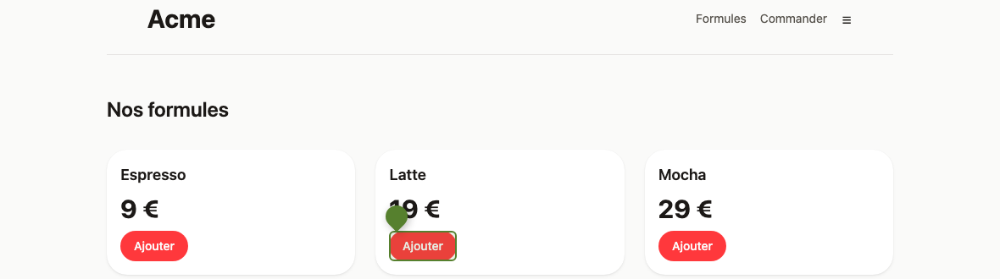
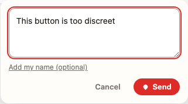

# 🍓 Fruitback

[](https://github.com/sakuga-software/fruitback/actions/workflows/ci.yml)
[](#licence)

**Visual feedback on a live site, delivered to your tracker.**

A client opens their staging site, clicks the element that bothers them, types a note. It lands as a
triaged issue carrying the CSS selector, the React component and the source file behind that element.
When they come back to the page, their pins are still there, coloured by the issue's status: new, to do, in progress, done or closed.
Each site can rename those statuses, recolour them, or add its own.



The guides are on **[fruitback.com](https://fruitback.com/)**,
and they are the files in [docs/](docs/).

**Self-hosted, Fruitback holds your feedback on your server, and nowhere else.** It stays in your
PostgreSQL, or lands in the tracker your team already uses. An administrator account in your own
console, and none anywhere else; a visitor who leaves a note needs no account at all. Fruitback Cloud
runs the same thing for you.

**It comes in three modes, and which one you want is the first thing to settle.** They differ on what
the site has to ship: **public**, where the site embeds the widget and every visitor can leave a
note; **private**, where the site embeds nothing and a browser extension puts the widget on it for
one reviewer; and **team**, where the site embeds a dormant widget that wakes up for a reviewer the
extension has signed in. One page each way — [docs/modes.md](docs/modes.md).

## Install, in public mode

Two lines on a site with no build step. `client` is the id of the site, which the console gives with
this tag, and `endpoint` is **your own worker** — the piece that holds the notes, or the tracker's API
key, because that key cannot ship in client-side JavaScript. It is one compose file:
[docs/self-hosting.md](docs/self-hosting.md).

The other two modes need the same worker and a browser extension on top; the reviewer's side of both
is [docs/reviewing.md](docs/reviewing.md).

```html
<script
  src="https://cdn.acme.dev/fruitback.iife.js"
  data-fruitback-endpoint="https://api.feedback.acme.dev"
  data-fruitback-client="site_29000420191b4eb2b0ea"
  defer
></script>
```

Or as an import, mounted after your app has rendered the elements it points at:

```ts
import { init } from 'fruitback';

const widget = init({ endpoint: 'https://feedback.acme.dev', clientId: 'acme' });
```

As a tag, for a page that prefers markup to a call (`@fruitback/element`):

```html
<script src="https://cdn.acme.dev/fruitback-element.iife.js" defer></script>
<fruitback-widget endpoint="https://feedback.acme.dev" client-id="acme"></fruitback-widget>
```

Or as a component in a React application (`@fruitback/react`):

```tsx
import { Fruitback } from '@fruitback/react';

<Fruitback endpoint="https://feedback.acme.dev" clientId="acme" />;
```

The five packages are on npm — [`fruitback`](https://www.npmjs.com/package/fruitback),
[`@fruitback/react`](https://www.npmjs.com/package/@fruitback/react),
[`@fruitback/element`](https://www.npmjs.com/package/@fruitback/element),
[`@fruitback/widget`](https://www.npmjs.com/package/@fruitback/widget) and
[`@fruitback/shared`](https://www.npmjs.com/package/@fruitback/shared) — and each has a README of its own.

The instance is **two files, five lines to fill, and one command**, and none of them needs a clone of
this repository:

```bash
curl -fsSLO https://raw.githubusercontent.com/sakuga-software/fruitback/main/docker-compose.yml
curl -fsSL https://raw.githubusercontent.com/sakuga-software/fruitback/main/.env.example -o .env
# fill the five lines .env asks for: the site, the database password, two secrets, your address
docker compose up -d --wait
```

It starts the worker, its PostgreSQL and the console. The sign-in link of the first administrator is
in `docker compose logs worker`; the console then adds the site and gives its script tag.
[docs/self-hosting.md](docs/self-hosting.md) is the path, seven steps from an empty folder to a pin a
visitor planted. CI runs this file from an empty directory the same way, recreates the containers and
reads the pin back. To update, run `docker compose pull` first: Compose does not pull a tag that is
already on the machine, and `edge` moves on every merge.

**The two images are not public yet.** Until an owner makes the packages public, log in to `ghcr.io`
with a token that has `read:packages` before `docker compose up` — see
[docs/self-hosting.md](docs/self-hosting.md#before-you-start).

The full walk-through — the site, the widget, a Linear team, several sites — is in
[docs/install.md](docs/install.md).



## Three ways to run it

The first question a reader has is whether their reviewers need the site to ship anything. All three
answers exist, and [docs/modes.md](docs/modes.md) is the page that picks between them.

|                                           | **Public**                            | **Private**                           | **Team**                         |
| ----------------------------------------- | ------------------------------------- | ------------------------------------- | -------------------------------- |
| The site embeds                           | the widget                            | **nothing**                           | the widget, dormant              |
| Delivered as                              | `<script>` tag or npm                 | a browser extension                   | `<script>` tag or npm            |
| Published                                 | **not yet** — build it from this repo | **not yet** — load it unpacked        | **not yet** — both of the above  |
| Who is **shown** the pins                 | every visitor                         | the reviewer who switched the site on | reviewers who are signed in      |
| Who can fetch them **with no credential** | anyone                                | anyone, or nobody                     | nobody, on a site members read   |
| Who supplies the credential               | nobody                                | **nobody can**                        | the reviewer, by connecting      |
| Good for                                  | a public "report a problem"           | reviewing a client's site, invisibly  | a team reviewing its own staging |
| Built                                     | **yes**                               | **yes**, MV3 on Chromium and Firefox  | **yes**                          |

**Who may read is the visibility of the site — « Members of … » or « Everyone who visits », chosen
in the console — and the mode decides who can satisfy it.** **Team mode is the only one where the
reviewer supplies a credential and the page never holds it**, attached in the extension's background.
**Private mode can supply nothing at all**: the widget it mounts has no token and no relay, so on a
site that members read its reads answer `401`, and on a site that everyone reads its pins are readable
by anyone who can build the URL — it changes who is _shown_ the feedback, never who may _fetch_ it.
[docs/modes.md](docs/modes.md) is the page that lays this out. The four lines a team-mode site adds are in
[docs/install.md](docs/install.md#team-mode-dormant-until-a-reviewer-arrives); what the relay
refuses is in [SECURITY.md](SECURITY.md#what-the-extension-relays-and-what-it-refuses-to).

The extension asks for **no host permission at install**: its content scripts are registered at
runtime, per origin, when somebody switches that site on.

## Where your feedback lives

**In your PostgreSQL, by default.** A workspace can send the notes of a site to a tracker it connects
in the console — a Linear workspace, a GitHub repository, or an address that receives them — and `FRUITBACK_STORE` picks
where the notes of a site with no tracker of its own go. Each connector reads only its own variables,
and an unknown name is refused at boot rather than quietly defaulted.

| `FRUITBACK_STORE`      | Needs                                                                                    | Good for                                                                                                                                                                     |
| ---------------------- | ---------------------------------------------------------------------------------------- | ---------------------------------------------------------------------------------------------------------------------------------------------------------------------------- |
| `postgres` _(default)_ | nothing more: the database every instance has                                            | No third party at all. The console lists the notes, and the pins on the page are the thread.                                                                                 |
| `linear`               | `LINEAR_API_KEY`, `LINEAR_TEAM_ID`                                                       | A team already triaging in Linear. Dashboard, API, MCP and integrations come for free.                                                                                       |
| `github`               | `FRUITBACK_GITHUB_APP_ID`, `FRUITBACK_GITHUB_PRIVATE_KEY`, `FRUITBACK_GITHUB_REPOSITORY` | A team whose issues are already on GitHub. Three stages instead of five: New while open, Done when closed as completed, Closed when closed as not planned or as a duplicate. |
| `memory`               | nothing                                                                                  | The dev loop. Refused under `NODE_ENV=production`.                                                                                                                           |

The database is the one the instance keeps its sites and accounts in, so keeping the notes there adds
nothing to run. What it gives up is the triage of a tracker: no assignee and no workflow. A member
sets the status of a note in the console or in the extension. Backups and what else you trade are in
[docs/self-hosting.md](docs/self-hosting.md#back-it-up).

GitHub Issues signs in as a GitHub App, never with a personal token: the worker mints a token that
expires after an hour and reaches one repository. Setting up the App is in
[docs/self-hosting.md](docs/self-hosting.md#storing-the-seeds-in-github-issues). Every connector plugs
into [`apps/worker/src/store.ts`](apps/worker/src/store.ts).

## Security, and what is open by default

Fruitback puts a widget in somebody else's page and a worker in front of somebody's issue tracker.
**[SECURITY.md](SECURITY.md) says where those boundaries are**, and it is worth reading before you
deploy rather than after. Two things surprise people most often:

- **On a site that everyone reads, `GET /feedback` answers anyone who can build the URL.** Every note,
  the name its reporter typed, and the team's replies are readable by any visitor of the site — and
  by `curl`. A site that only members read answers a session of its workspace and nobody else. The
  console asks which when the site is added, and « Members of … » is the default.
- **The id of a site is asserted by the browser, never authenticated.** The address of the site makes
  the claim checkable against the browser's own `Origin` header — the trust level CORS gives, and no
  more.

It also says how to report a vulnerability.

## Documentation

|                                              |                                                                                        |
| -------------------------------------------- | -------------------------------------------------------------------------------------- |
| [docs/modes.md](docs/modes.md)               | The three modes, what each protects, and which one you want                            |
| [docs/install.md](docs/install.md)           | Putting the widget on a site, end to end                                               |
| [docs/translating.md](docs/translating.md)   | Adding a language to the widget's bundle                                               |
| [docs/reviewing.md](docs/reviewing.md)       | The reviewer's side: the extension, switching a site on, pairing                       |
| [docs/self-hosting.md](docs/self-hosting.md) | Running the worker: the image, the tags, a deployment                                  |
| [docs/privacy.md](docs/privacy.md)           | What a note carries, where it goes, how to delete it. Not legal advice                 |
| [docs/architecture.md](docs/architecture.md) | Why this shape, the seed contract, the layout, the commands                            |
| [docs/decisions/](docs/decisions/)           | Per-subject rules and histories: what was measured, what failed first                  |
| [SECURITY.md](SECURITY.md)                   | The threat model, stated rather than implied                                           |
| [CONTRIBUTING.md](CONTRIBUTING.md)           | Running the project, what must pass, the conventions, adding a connector               |
| [CODE_OF_CONDUCT.md](CODE_OF_CONDUCT.md)     | The Contributor Covenant, and where to report a breach                                 |
| [CLAUDE.md](CLAUDE.md)                       | What no lint rule and no test catches, for anyone — human or agent — writing code here |

Work is tracked in Linear on the
[Fruitback](https://linear.app/sakuga-software/project/fruitback-ed574263d8d6) project (team Fruitback, key `FRU`).

## Licence

Two licences, split where the client/server boundary is (FRU-22).

|                                                                                                  |                   |
| ------------------------------------------------------------------------------------------------ | ----------------- |
| `packages/widget`, `packages/shared`, `packages/fruitback`, `packages/element`, `packages/react` | **MIT**           |
| `apps/worker`, `apps/console`, `apps/extension`                                                  | **AGPL-3.0-only** |

The five client-side packages are **MIT** because they are compiled into someone else's site: a
copyleft licence on code that ships inside a client's own bundle is one nobody can adopt, and the
widget is worth nothing unadopted. The worker is **AGPL-3.0-only** — it is the server, the only place
copyleft actually bites, so anyone who hosts a modified version publishes their modifications.
Copyright (C) 2026 Sakuga Software; the full text is in
[`apps/worker/LICENSE`](apps/worker/LICENSE).

`@fruitback/widget` compiles `react-grab` and `zod` **into** its `dist` rather than asking a client
site to install them. Both are MIT, and MIT requires their notices to travel with the code, so the
tarball ships [`THIRD-PARTY-NOTICES.md`](packages/widget/THIRD-PARTY-NOTICES.md) — checked by the
suite, not by hand. `apps/playground` is not published; it inherits the repository's MIT licence.
