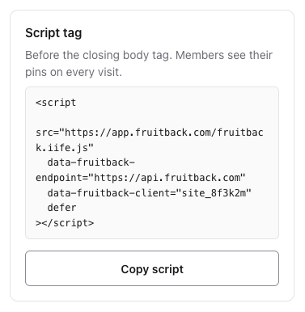

# Install the widget

Three things have to exist: **an instance** — the worker, its PostgreSQL and its console — **a site**,
made in the console, and **the widget**, which goes on the pages of that site. The widget writes to the
worker, and the worker answers only the sites its console made.

Do the instance first, then the site. The widget needs the address of the worker and the id of the
site.

**Which mode you are installing changes step 3 and nothing else.** Step 3 is where public mode puts the
widget on the page, team mode ships it dormant, and private mode ships nothing at all — there the
extension mounts it, and the reviewer's side is [reviewing.md](reviewing.md). [modes.md](modes.md) is
the page that picks between the three, and it is worth reading first: **who may read a site is the
visibility you choose at step 2, and the mode decides who can satisfy it.**

> **The packages are not on npm yet.** Everything below describes the shape of the install; the
> `npm i` lines will work once the first release is published. Until then, the `<script>` route works:
> the console serves the script of the widget at `/v/<version>/fruitback.iife.js` (the snippet of the
> console gives it) and at `/fruitback.iife.js`, and
> `pnpm --filter @fruitback/widget build` produces the same file.

---

## 1. The instance

**Fruitback Cloud** runs it for you. **Self-hosted**, it is three containers that one compose file
starts: [self-hosting.md](self-hosting.md) goes from an empty folder to a pin in seven steps, and this
page does not repeat them. Every instance keeps its notes, its sites and its accounts in PostgreSQL,
and has an administrator who signs in to the console. A visitor who leaves a note needs no account.

Two things matter whatever you deploy with:

- **`/health` checks the configuration, not the database or a tracker.** It answers `503` and names
  each variable that is missing or wrong. It answers `200` while the database does not answer, or
  while Linear refuses a key: those show on the first read, as `502 store-unavailable`. So check a
  read as well, at step 2.
- **`TRUSTED_PROXY_HOPS` is the number of proxies in front of the container**: `0` when the port is
  published directly, `1` behind one Traefik. Too high behind a proxy that appends to
  `X-Forwarded-For`, and a caller escapes the rate limit with a forged header. Too low, and every
  caller shares one bucket. [Behind a reverse proxy](self-hosting/reverse-proxy.md#behind-a-reverse-proxy) has the
  measured cases and a check you can run.

To try the whole loop from the sources with no Linear account at all, `pnpm dev` runs the worker with
a database in its process and an in-memory Linear, and serves the playground next to it. Nothing is
written to anyone's workspace.

---

## 2. The site

In the console, add the address of the site, and choose **who sees the notes**:

- **Members of the workspace** — the default. A read needs the session of a member, which the
  extension gets when the reviewer connects it: this is the team mode. « Who can leave a note » is
  « Members only » on a new site (FRU-330): a visitor with no session is refused. With « Anyone on
  the page », a visitor can send a note, and sees no pin, theirs included.
- **Everyone who visits** — a read needs nothing: this is the public mode. Every note, the name its
  reporter typed and the replies are readable by anybody who knows a page address and the id of the
  site, with or without the widget.

The console then gives the script tag of the site. `data-fruitback-client` in it is **the id of the
site**, `site_…`: it is the `clientId` of every example below. The worker answers the page of each site
by itself; nothing to add to `ALLOWED_ORIGINS`.

Check a read before going further, with the address of a page of the site, encoded, and its id:

```bash
curl -H 'Origin: https://staging.acme.test' \
  'https://api.feedback.acme.dev/feedback?url=https%3A%2F%2Fstaging.acme.test%2F&client=site_…'
# {"url":"https://staging.acme.test/","issues":[],…}
```

On a site that only members read, that read answers `401` with no session, which is expected.

### A Linear team for the whole instance

The notes of a site go to the database of the instance, unless its workspace connects a tracker in the
console, and the site chooses it. A self-hosted instance can also send the notes of every site with no
tracker of its own to one Linear team: `FRUITBACK_STORE=linear`, with two values and a key in `.env`.

**The API key** — a personal API key from your Linear settings. It is a secret: it must never reach a
browser, and that is one reason the worker exists.

**The team, and optionally the project.** Both are UUIDs. The quickest way to read them is to ask
Linear:

```bash
curl -s https://api.linear.app/graphql \
  -H "Authorization: $LINEAR_API_KEY" \
  -H 'Content-Type: application/json' \
  -d '{"query":"{ teams { nodes { id key name } } }"}'
```

Swap `teams` for `projects` for the other one. A project is optional: without it, issues are created
in the team's default.

```bash
FRUITBACK_STORE=linear
LINEAR_API_KEY=lin_api_…
LINEAR_TEAM_ID=…
```

**Labels need no setup.** Fruitback creates `fruitback`, and a label for the site of the note, on
demand, on first use. A label that cannot be created is dropped and the feedback still goes
through: losing a label is a triage annoyance, losing someone's note is a bug.

---

## 3. The widget

### A script tag

For a site with no build step. `endpoint` and `client` are required and are the whole configuration;
`label` is optional. The console gives this tag, with the address of its own copy of the script and
the id of the site.



```html
<script
  src="https://cdn.acme.dev/fruitback.iife.js"
  data-fruitback-endpoint="https://api.feedback.acme.dev"
  data-fruitback-client="site_…"
  data-fruitback-label="Leave feedback"
  defer
></script>
```

Add `data-fruitback-include-env="true"` to send the reporter's user agent, language and platform
with each note. It is off by default, and [privacy.md](privacy.md) says what that means for your
notice.

`defer` matters: the widget mounts into `<body>`. It auto-mounts only when **both** `endpoint` and
`client` are on the tag; with either missing it does nothing and `Fruitback.init(…)` is yours to call
— which is what a site with its own bootstrap wants.

### An import

```bash
npm i fruitback
```

```ts
import { init } from 'fruitback';

const widget = init({
  endpoint: 'https://api.feedback.acme.dev',
  clientId: 'site_…',
});
```

In React, mount it in an effect — the widget points at elements your app has rendered, so it has to
arrive after they do:

```tsx
useEffect(() => {
  const widget = init({ endpoint: WORKER_URL, clientId: 'site_…' });

  return () => widget.destroy();
}, []);
```

`init` is browser-only and says so if called while server-rendering, rather than failing somewhere
inside a bundle.

### A React component

```bash
npm i @fruitback/react
```

```tsx
import { Fruitback } from '@fruitback/react';

<Fruitback endpoint="https://api.feedback.acme.dev" clientId="site_…" />;
```

It renders nothing, mounts the widget in an effect and destroys it when it unmounts. Its props are
the options of `init`. A parent that renders again does not mount the widget again: an object such as
`theme` is compared by its value, and a function such as `identityToken` is always the one of the
last render. `onMount` hands you the widget, for `refresh()` or `feedbackAsText()`, and for a way in of your own:
`leaveFeedback()` starts choosing an element, `showEveryNote()` opens the list, and `pageCounts()` says
how many notes of each stage the page shows (FRU-254).

### A custom element

```bash
npm i @fruitback/element
```

```ts
import '@fruitback/element/auto'; // registers <fruitback-widget>
```

```html
<fruitback-widget endpoint="https://api.feedback.acme.dev" client-id="site_…"></fruitback-widget>
```

On a page with no build step, load `fruitback-element.iife.js` from the package's `dist` instead of
the import. The element reads `endpoint`, `client-id`, `label`, `locale` and `include-env`. What an
attribute cannot carry goes through a property: `element.options = { theme, identityToken }`. Without
an `endpoint` and a `client-id` it mounts nothing, and it takes the widget away when it leaves the page.

### Team mode: dormant until a reviewer arrives

Ship the widget and call `init` only when a reviewer with the extension opens the page. Your users
see nothing; your reviewers see their pins.

```ts
import { init, type FruitbackTransport } from 'fruitback';

// The extension puts this on the page. It is not part of the package, so your project declares it.
declare global {
  interface Window {
    fruitbackExtension?: { version: number; transport: FruitbackTransport };
  }
}

let widget: ReturnType<typeof init> | undefined;

const sync = () => {
  const extension = window.fruitbackExtension;

  // Gone: the reviewer switched this site off, or to private mode. The extension cannot destroy a
  // widget your site owns, so it tells you and you do.
  if (extension === undefined) {
    widget?.destroy();
    widget = undefined;

    return;
  }

  if (widget !== undefined) return;

  widget = init({
    endpoint: 'https://api.feedback.acme.dev',
    clientId: 'site_…',
    // Every call goes through the extension, which attaches the reviewer's session.
    transport: extension.transport,
  });
};

window.addEventListener('fruitback:extension', sync);
sync();
```

Both halves are needed: the event for a page that loaded before the extension announced itself, the
call for one that loaded after. The **same event fires when the extension withdraws**, so `sync`
reads the property rather than assuming an arrival — and it is written so a second announcement
cannot mount a second widget.

The reviewer then turns your origin on in the extension's popup, in **Team** mode, and pairs with
the worker, from the console. Until they do, the extension relays nothing — see
[the threat model](https://github.com/sakuga-software/fruitback/blob/main/SECURITY.md#what-the-extension-relays-and-what-it-refuses-to) for why, and for
the five other things the relay checks first.

> This mode is worth turning on only for a site that « Members of … » read. On a site that everyone
> reads, the same pins are readable by anyone who can build the URL, and all it buys is a page your
> users do not see the widget on.

---

## Next steps

- [Widget options](install/widget-options.md): what else `init` takes, and the feedback of a page as text.
- [Several sites, one instance](install/several-sites.md): a site per client, each bound to its address.
- [Identified reporters](install/identified-reporters.md): when a reporter is verified, and when a name is only a claim.
- [Translate the widget](translating.md): the language of the widget, and your own words.
- [What the team sees](install/team-view.md): the « Notes » screen, or an issue in a tracker.
