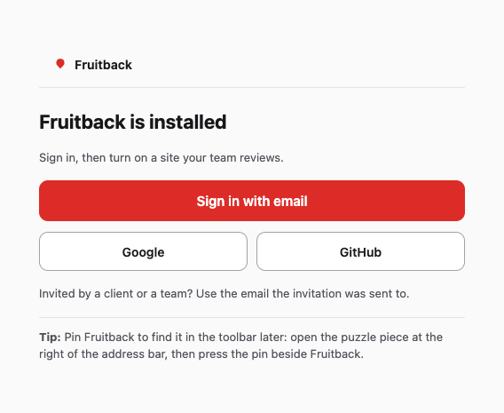
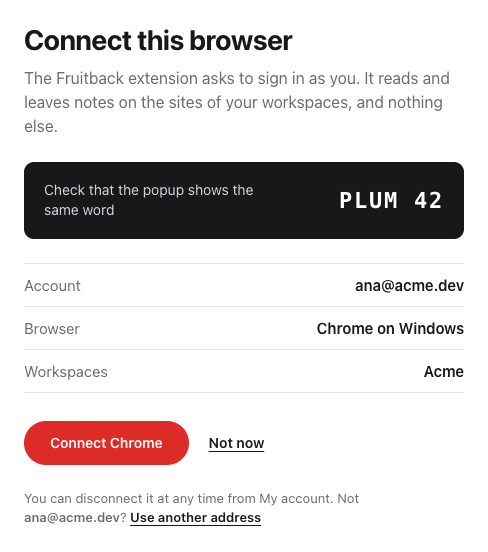
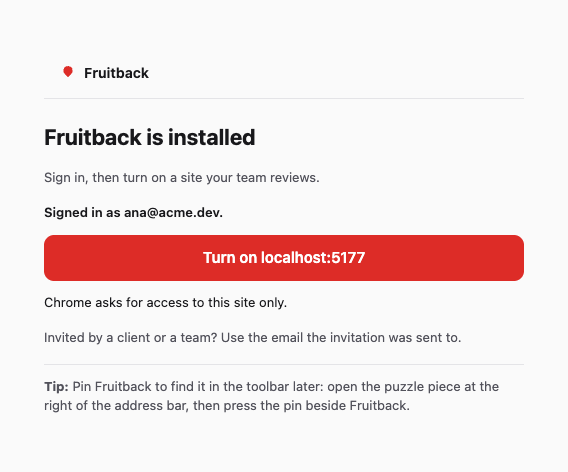
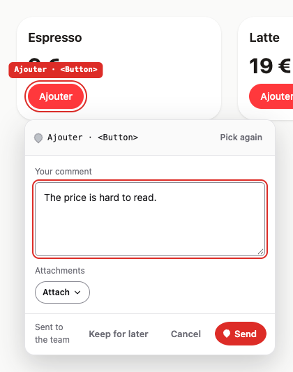
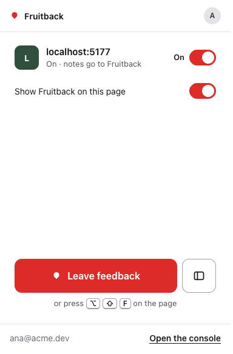
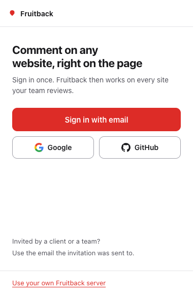

# Review with the extension

This is the reviewer's side. The site's side and the worker's are in [install.md](install.md); which
mode you want is in [modes.md](modes.md).

Both extension modes start the same way — install it, switch an origin on — and diverge on one
question: **does that site embed the widget itself?** If it does, that is team mode and you will pair
with the worker. If it does not, that is private mode and the extension mounts the widget for you.

## 1. Install it

The extension is in beta. **In Chrome or Edge**, add it from the
[Chrome Web Store](https://chromewebstore.google.com/detail/fruitback/jjjemdloknmggncbickofjgbodplekoa).
**In Firefox**, add it from
[addons.mozilla.org](https://addons.mozilla.org/en-US/firefox/addon/fruitback/); it asks for Firefox
140 or later. Then go on at step 4 below.

A browser that reaches neither store installs the archive of the last release by hand, once.

**By hand, in Chrome, Edge, Brave or Arc:**

1. Download `fruitback-<version>-chrome.zip` from the
   [last release](https://github.com/sakuga-software/fruitback/releases/latest), and unzip it. Keep
   the folder: the browser loads the extension from it.
2. Open `chrome://extensions` in a new tab, and turn on **Developer mode**, at the top right.
3. Choose **Load unpacked**, and pick the folder you unzipped.
4. A Fruitback tab opens by itself. Choose **Sign in with email**, **Google** or **GitHub** there:
   section 2 goes on from there.
5. To find Fruitback in the toolbar later, pin it: open the puzzle piece at the right of the address
   bar, then press the pin beside Fruitback. Nothing needs it to leave a first note.

**By hand, in Firefox**, to try a build that is not on addons.mozilla.org yet: download
`fruitback-<version>-firefox.zip` from the same release, open
`about:debugging#/runtime/this-firefox`, choose **Load Temporary Add-on…** and pick the archive.
Firefox keeps such an add-on until it restarts.

An extension installed by hand does not update itself. Its popup and its page say so when a newer
release is out, **Fruitback 0.6.0 is out. Update**, with a link to that release: install its archive
the same way. One from the Chrome Web Store or from addons.mozilla.org updates on its own, and says
nothing.

**From the sources**, if you work on the extension:

```bash
pnpm install
pnpm --filter @fruitback/extension build           # or build:firefox
```

That writes `apps/extension/.output/chrome-mv3/`, which you load as in step 3. `pnpm --filter
@fruitback/extension dev` does the same with a reload on every change.

**It asks for no host permission at install**, and that is deliberate: it can read nothing anywhere
until you switch a site on, and it asks then, for that origin. Chromium will say the extension can
read and change data on the site you name — that is the grant, and it is what lets a content script
run there.

## 2. Switch a site on

### With Fruitback Cloud

There is nothing to type. Step 3 of the setup of the console shows the same steps, with the same
captures.

<!-- guide:start: written from apps/console/app/guide-steps.ts by `node apps/console/guide-docs.ts`. -->

1. Install the extension. A Fruitback tab opens: choose **Sign in with email** there.

   

2. A tab of the console opens with a word. Check that the Fruitback tab shows the same word, then press **Connect Chrome**.

   

3. Back on the Fruitback tab, press **Turn on your site**. Chrome asks once for access to that site: allow it.

   

4. The site opens, ready for a note: click the part of the page it is about, write what should change, then send it.

   

5. Later, the Fruitback icon in the toolbar opens the same tools on any site of your team: **Leave a note** starts a note.

   

The captures are of the extension 0.6.0, taken by `e2e/first-note.spec.ts`.

<!-- guide:end -->

**On any other page**, the popup of the Fruitback icon offers the same sign-in while the browser is
signed out: **Sign in with email**, **Google** or **GitHub**. All three open the console in a tab,
which signs you in its own way, and the popup shows the word that the console shows. Invited by a
client or a team? Use the email the invitation was sent to.



**On a site of one of your workspaces that is not on yet**, the popup asks
**Turn Fruitback on for this site?**, says where its notes go and who sees them, and offers **Turn on**. One click: the
browser asks for access to that site only, and the widget appears, reading and writing as you. On a
site of none of your workspaces, an owner or an admin gets the same question with **Turn on**, and a
list of the workspaces when there are several: the browser asks for access to the site, the site is
added to that workspace, for its members only, and the widget appears.

**Once a site is on**, the popup has a switch to turn it off and on, **Notes go to** with the mark
of the tracker and its place (**Change** opens the same lists as « Turn on », for a role that may
change them), the fixes the team marked done for you to check and the open notes of the site, then,
at the bottom, **Leave a note** with its keys and, beside it, the panel icon
**Show all notes in a sidebar**; a click on a line opens the side panel too. The side panel opens
beside the page: **Notes on this page**, with **Open** and **Done**, the replies of a note,
**Show on the page**, and **Reply** where your role may reply. A click on a pin opens its row; the panel follows
the tab you look at. **Alt+Shift+F** (Option+Shift+F on a Mac) starts a note too, on a site that is
on: the page of the extension shows the key under Preferences, and opens the settings of your
browser to change it.

To set a site up by hand, the button at the top right of the popup, **Account and settings**, opens
the options page.

If a site is on and its access was removed in the settings of the browser, the popup says
**Fruitback can't open this page**, and the site is **Paused**: your notes are safe.
**Allow access again** asks the browser for that site once more, and the widget comes back.
**Turn off for this site** keeps the rule, off.

If your session ends, the widget says so on the page: its button reads « Sign in to leave notes » and
opens the popup, where you sign in again. What you were writing stays.

### On your own server

The words _worker_, _mode_ and _client id_ belong to this part only. On a server you run yourself,
the console's **Connect this browser** opens a pairing link of that server (section 3).

On a worker you run yourself, or on a site of no workspace, open the page you want to review and
click the extension. While this browser holds no session at all, the foot of the popup offers
**Use your own Fruitback server**, and the options page asks for the three things below. Once it holds one, the popup names
the site it is about and asks for them itself:

| Field              |                                                              |                                                                |
| ------------------ | ------------------------------------------------------------ | -------------------------------------------------------------- |
| **Mode**           | `Private · the extension shows the widget`                   | for a site that embeds nothing                                 |
|                    | `Team · the site embeds it, the extension adds your session` | for a site that ships a dormant widget                         |
| **Server address** | `https://feedback.acme.dev`                                  | your worker, not the site                                      |
| **Client id**      | `acme`                                                       | **private mode only** — in team mode the site declares its own |

Then **Turn on for this site**. The browser asks for permission on that origin; refuse it and nothing
runs. The row afterwards reads `On · acme` in private mode, and in team mode
`On · team mode · the site's own widget` — where the client id would be, because there the site
declares its own. Either row carries **Turn off here** and **Change**.

**Turn off here** also gives the access to that site back to the browser, so the browser no longer
lists the site under what Fruitback can read. To turn the site on again, the browser asks you again.
The access to a worker stays while another site that is on uses it, or while you are paired with it;
it goes back when you sign out and no site that is on uses that worker.

A grant reaches the **next** page load, so the popup injects into the tab you have open. Come back to
the page and the widget is there.

**If a private-mode site shows no note, open the popup.** When the worker reads `authenticated`, the
popup says `This server answers a signed-in reader only, and in private mode the extension holds no session. Notes do not show on this site.`,
with a link to [the three modes](modes.md). Private mode carries no session, so the fix is on the
worker's side: read `public` for that client, or use team mode. The popup says nothing when the
worker is down or slow, because it did not measure why.

**If a private-mode site takes no note**, the site is « Members only » (FRU-330), the default of a new
site of the console: the popup says
`This site takes notes from its members only, and in private mode the extension holds no session: no note can be sent from here. To review it in private mode, an admin of the site sets « Who can leave a note » to « Anyone on the page » in the console.`
The widget offers no note there. An admin of the site adds its address again on the Sites screen of
the console with « Anyone on the page » (the site keeps its notes and its id), or the reviewer
connects the browser and uses team mode.

**A team-mode endpoint must be `https`, or loopback for the dev loop** — a session is a bearer
credential and it does not cross plain `http`, so the popup refuses the entry rather than storing one
that would be shown as **On** and refuse every call. **Private mode accepts plain `http://`**, and
that is deliberate: the widget it mounts carries no credential, so there is nothing on the wire to
protect, and an `http://` staging site is exactly the thing this mode is for.

## 3. Pair, in team mode

Private mode needs nothing more — the widget is mounted, and it reads as an anonymous visitor would.
The popup offers no pairing there, because a session would change nothing. If you already hold a
session with that worker, the popup still shows it, with **Sign out**.
Team mode relays every call through your session, so until you pair the site can reach nothing:

> Not connected. This site cannot reach the server until you connect.

**Every worker holds sessions since FRU-225**: they are in its PostgreSQL, whatever `FRUITBACK_STORE`
says, and `FRUITBACK_IDENTITY_SECRET` signs the access token. The usual way is « Connect this
browser » in the console. That is the operator's side, in
[self-hosting/worker.md](self-hosting/worker.md), which lists the `/session/` routes.

**A pairing code is minted by an operator, on the container, never over HTTP:**

```bash
docker compose exec worker node server.mjs pair --subject <your account id> --workspace <id> --name "Alex" \
  --endpoint https://feedback.acme.dev
```

The code is for one workspace you are a member of, and your account must exist: sign in to the console
once before you ask for it.

The name in that command is what your notes will be signed with. The worker vouches for it because
an operator typed it; the browser never asserts its own identity, which is the whole reason the code
comes from a person rather than a form.

With `--endpoint`, the address the worker answers at, the command prints a **link** as well as the
code: `https://feedback.acme.dev/pair#ABCD-EFGH-JKMN`. That is what the operator sends you.

1. Open the link. The page says what to do, and it is all it does: it runs no script.
2. Click the Fruitback icon in the toolbar, on that tab. The popup reads
   `This page is a connection link for https://feedback.acme.dev.` — **read the address**: it is the
   worker you are about to trust with your notes.
3. Press **Connect to this server**. The popup then reads `Connected as Alex`, with **Sign out** beside
   it. Go back to the site: it reaches the worker now.

The page of the extension does the same, worker by worker: **Servers and sessions** has a card for
each worker a rule names, with who you are connected as and **Sign out**, or a field for the code and
**Connect**. From the popup of a pairing link, **Connect in the page of the extension** opens that card with
the code filled in.

The code is after the `#`, and a browser sends nothing after a `#` to a server, so the worker's logs
do not hold it. It is still in your browser's history, and it is spent the moment you pair.

**If you were given a code and no link**, open the popup on the site, press **I have a code**, and
paste it into the field above **Connect to this server**.

On a worker that is not on `https`, there is nothing to paste into: the button is disabled before you
get that far, under

> Connecting needs https (localhost excepted): a session must not cross http.

with **Change the server** beside it, which opens the fields of the rule.

Otherwise, what a failed attempt answers. Each message has the one thing to do about it beside it:

| The popup says                                                                          | Why                                                                                                                                                                              | Beside it                                     |
| --------------------------------------------------------------------------------------- | -------------------------------------------------------------------------------------------------------------------------------------------------------------------------------- | --------------------------------------------- |
| `That code has been used or has expired. Ask for a new one.`                            | Codes are single-use, and expire 15 minutes after they are minted.                                                                                                               | **How to get a code**, a link to this section |
| `The server did not answer. Try again.`                                                 | The worker is down or unreachable — the code is still good.                                                                                                                      | **Try again**, with the same code             |
| `Fruitback needs permission to reach that server.`                                      | The prompt for the **worker's** origin was refused. It is not the site's.                                                                                                        | **Grant access**, which asks again            |
| `That server is on plain http, and a session must not cross it. Use its https address.` | The same rule as the disabled button above, answered by `session.ts` rather than by the popup. You reach it only if something else asks for a pairing — the popup refuses first. | **Change the server**                         |

Pairing asks for a permission on the worker's origin, which is a different grant from the site's. It
is asked for at the click, so nothing is awaited before the prompt — a browser drops the gesture
otherwise and no prompt ever appears.

Two more messages can show on the popup and on the options page, for a site and not for a pairing:

| The page says                                                              | Why                                                                                | Beside it                                                     |
| -------------------------------------------------------------------------- | ---------------------------------------------------------------------------------- | ------------------------------------------------------------- |
| `Fruitback needs access to those sites to run there. Nothing was saved.`   | You refused the browser's prompt for the site.                                     | **Grant access**, which asks again                            |
| `Fruitback could not confirm that change. Check the list, then try again.` | The change went to the extension and no answer came back. It can be stored anyway. | **Check the list**: the options page, read again from storage |

A message with no button is one the page cannot act on: a field to correct, which is beside the
message, or a rules file that only another file replaces.

## 4. Many sites, from the options page

The popup switches the site you are on, and names the rule that covers it. On a site that no rule covers, the
popup says `No rule covers this origin, so Fruitback does nothing here.` The button at the top
right of the popup, **Account and settings**, opens the options page, which lists every rule and
adds new ones.

The page of the extension (FRU-301) has a menu on the left, and **Sites** first: a table of every
rule with its **Mode**, its **Worker**, its **Access** and a switch to turn it on or off. **Filter
sites** narrows the table by pattern or by worker. Click the site of a row, or press Enter on it, to
open its panel: the mode, the **Server address**, the **Client id**, what this browser holds for it,
**Save** and **Remove rule**. **Add a site** opens the form of a new rule in the same place.

A rule names the sites it covers:

| Sites                        | covers                                                            |
| ---------------------------- | ----------------------------------------------------------------- |
| `https://acme.dev`           | that origin only                                                  |
| `https://*.staging.acme.dev` | `staging.acme.dev` and every subdomain of it, on the default port |

The access the browser grants for a wildcard covers every port of those hosts; the widget mounts only
on the default port, and unmounts on any other. A host with no scheme is read as `http://` when it is local (`localhost`, `*.localhost`, `*.local`, `127.0.0.0/8`, `[::1]`, `10/8`, `172.16/12`, `192.168/16`), and as `https://` otherwise. A wildcard needs a domain with a dot and no IP address, so
`*.localhost` is refused: add each local origin on its own. When two rules cover a site, the rule for the exact origin
wins, then the longest wildcard. So one preview can go to another client, or be switched off, under a
rule for all of them. **A site that no rule covers mounts nothing**: there is no default client.

**Add rule** asks the browser for access to every site the pattern covers, and stores nothing if you
refuse. On a site a wildcard covers, the popup's switch reads `Turn off for every site this rule covers`,
because that is what it does.

**A team-mode rule names one origin, never a wildcard.** The relay spends your session for the page a
team rule covers, and a wildcard such as `https://*.vercel.app` covers sites that are not yours. The
popup, the options page and an imported file all refuse a wildcard in team mode. A wildcard stays
valid in private mode, which carries no session. A team wildcard that an earlier version stored runs
nowhere now: the options page says so on its row, and offers to remove it.

**A wildcard is a convenience in your browser, and grants nothing on the worker.** The worker compares
each page's exact origin with the `origins` of its client, so `pr-12.staging.acme.dev` has to be listed
there too, or its notes are refused. That check applies in private mode, where the widget calls from the
page; in team mode the call comes from the extension, which the worker does not hold to `origins`.

### Share rules with a team

In **Share rules**, **Download** writes `fruitback-rules.json`. To read one, drop it on
**Import a rules file**, or click the card and choose it. A rule in the file replaces the rule with the same
pattern, and the other rules stay. An entry that does not parse is skipped, and the card names it. A
file from an earlier version, `fruitback-sites.json`, is read the same way: the import reads what the
file holds, not its name.

The file holds patterns, modes, endpoints and client ids. It holds no session and no access, so an
imported rule says « imported » under its site, and reads `No access in this browser` in its panel
until you press **Grant access**, and a
team-mode worker still needs you to pair. A rule that is off reads `No access while it is off`: its
switch asks for it.

### Keep your rules in your other browsers

The rules stay in the browser that holds them, unless you tick **Keep my rules in the account of
this browser**, at the end of the options page. The browser then keeps them with the account you
signed it in with, and they reach your other browsers where the box is ticked too.

- **What travels**: patterns, modes, endpoints and client ids, whether a rule is on, the label of
  the launch button when a rule has one, and the name of the workspace of a site you turned on from
  your session. **No session
  and no access**: on another browser a rule reads `No access in this browser` until you press
  **Grant access**, and a team-mode worker still needs you to pair there.
- **Who keeps them**: the vendor of the browser (Google for Chrome, Mozilla for Firefox), under its
  own terms. The addresses of your staging sites are in those rules.
- A rule you remove is removed in your other browsers where the box is ticked. Turning the box off
  stops the copy, and removes nothing from the account.
- **A browser where the box was off does not hear of the removals made meanwhile.** When you tick it
  there, the rules it still holds go back to the account, and to your other browsers: remove them
  again, or remove them in that browser before you tick the box.
- The account keeps at most 8 KB for one rule. A larger rule, with a very long label for example,
  stays and works in this browser, is not copied, and its row in the options page says so.
- Firefox with no account keeps them on the machine, as before.

## When Fruitback does not answer

Open the popup first. It names most of these problems itself. Each case below gives what you see,
then what to do.

### The sign-in did not finish

The popup shows the sign-in buttons again, with the reason above them.

| The popup says                                                                                                   | Why                                                                 |
| ---------------------------------------------------------------------------------------------------------------- | ------------------------------------------------------------------- |
| `Someone declined it in the console. Sign in again to retry.`                                                    | Someone pressed **Not now** in the tab of the console.              |
| `The console did not approve it within 15 minutes. Sign in again.`                                               | The request expired before anyone pressed **Connect Chrome** there. |
| `Check the connection, then try again.`                                                                          | Fruitback could not be reached. Check that the browser is online.   |
| `The browser did not give the extension access to Fruitback. Sign in again, and allow it when the browser asks.` | You refused the browser's prompt for Fruitback itself.              |

While the popup waits for the console, it shows the word to check. If it reads
`Fruitback did not answer. The popup asks again.`, it asks again by itself. **Start again** makes a
new request.

**Your session can end later.** The popup then reads `Your sign-in ended`, and the button of the
widget on the page reads `Sign in to leave notes`. Sign in again from the popup. What you were
writing stays.

### Fruitback Cloud does not answer

The popup reads `Fruitback can't reach` and the address of Fruitback, with
`Check the connection, then try again.` Your session is kept. Check that the browser is online,
then press **Try again**.

A note that does not go through stays in the widget, under `Not sent`:
`Your text is still here. Try again, or copy it before you close the page.`

### Your own server does not answer

On a site that uses a worker you run yourself:

- `The server of this rule does not answer. Check its address in the options.` means that something
  answered at that address, and it was not a worker. Correct the **Server address** of the rule on
  the options page.
- When the worker is down or slow, the popup says nothing about it. The widget keeps the note you
  send and says `Not sent`. Ask the person who runs the worker to check it. Their side is
  in [self-hosting/troubleshooting.md](self-hosting/troubleshooting.md).
- A pairing that gets no answer reads `The server did not answer. Try again.` The code stays good
  until it expires. Press **Try again** once the worker is back.

### Access was removed in the settings of the browser

The popup reads `Fruitback can't open this page`, and the site is **Paused**. Your notes are safe.
Press **Allow access again**. The browser asks for that site once more, and the widget comes back.

### The widget does not show after Turn on

Reload the page. The extension puts the widget into the tabs that are open on the site when you
turn it on, and the browser refuses that in some tabs: an error page, or a page that another
extension controls. The next load of the page gets the widget.

If the popup reads `Another copy of Fruitback runs on this page`, reload the page too. A tab that
was open while the extension updated keeps the script of the earlier version. If the line stays
after the reload, remove the other copy from the extensions page of your browser.

## Who can add a site to a workspace

**An owner or an admin of the workspace.** A member can turn on a site that is already in their
workspace, and a guest the sites shared with them. Neither can add a new one.

On a site of none of your workspaces:

- If you are an owner or an admin of at least one workspace, the popup offers **Turn on**. It adds
  the site to the workspace you choose.
- Otherwise the popup reads `Ask an admin of your workspace to add this site.`, and has no button.
- If your role changed in the meantime, **Turn on** answers
  `Your role in this workspace does not let you add a site.`

**What to ask an admin.** Send the address of the site, as the browser shows it, and the name of
the workspace. The admin adds it on the **Sites** screen of the console, with **Add a site**. Then
open the popup on the site again: it offers **Turn on**.

The popup adds a site over `https` only, or on the loopback (`localhost`, `127.0.0.1`). Add a
staging site on plain `http` from the console. One account adds 10 sites an hour at most from the popup; past that, it reads
`Too many sites were added in the last hour. Try again later.`

## What log out does, and what it cannot undo

**Sign out** revokes the session on the worker first, then clears both tokens here. The refresh token
is dead and the chain with it, so nothing can be renewed. The access token already minted is not
reachable by a revoke — nothing checks a list when one is presented — and it stops working on its
own. That window is the token's **11 minutes**: its 10 minutes of life, plus the 60 seconds of clock
skew the verifier allows past the moment it expires. Raised in review, which counted the lifetime
and found the document counting one minute less than the code.

If the worker cannot be reached, the tokens are cleared here anyway. A screen saying signed out over
a credential this extension still holds would be the worse of the two, and the token on the worker
expires within 30 days regardless.

## What the extension never does

- **It does not put a token in the page.** The access token lives in the extension's trusted
  contexts, and the widget asks the background to make the call. A page can forge messages on the
  bridge and still cannot ask for one.
- **It does not relay to a worker the page did not name.** A page declaring another endpoint is
  refused rather than answered with your credential for a worker nobody on that page chose.
- **It does not reach a site you have not switched on.** Content scripts are registered per origin,
  at runtime, and unregistered when you switch it off.

The full list, and what each refusal is for, is in
[SECURITY.md](https://github.com/sakuga-software/fruitback/blob/main/SECURITY.md#what-the-extension-relays-and-what-it-refuses-to).
